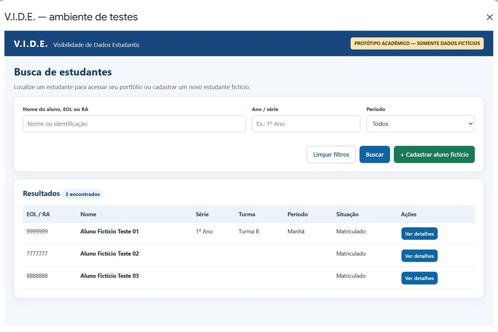
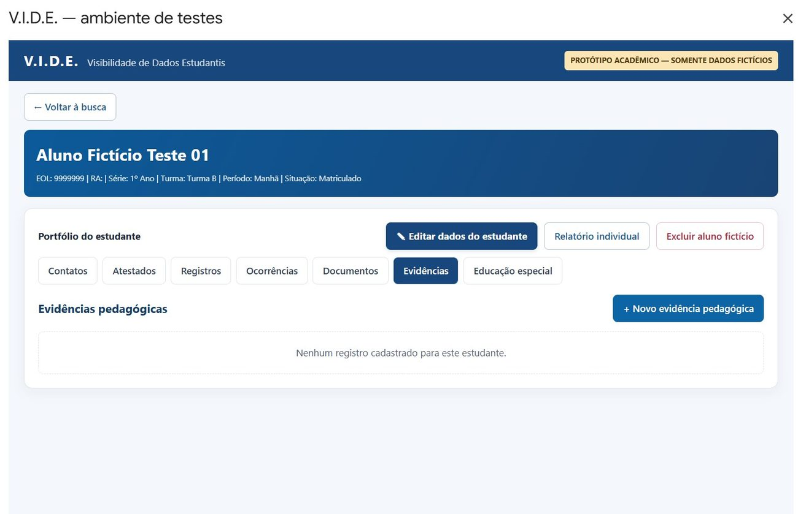

# V.I.D.E. — Visibilidade das Informações de Dados Estudantis

**Projeto Integrador em Computação II · Protótipo acadêmico · 2026**

O V.I.D.E. é um sistema demonstrativo para organizar informações de estudantes em um portfólio individual. A implementação combina uma interface HTML/CSS/JavaScript, regras de negócio em Google Apps Script, armazenamento tabular em Google Planilhas e gerenciamento de anexos pelo Google Drive.

> **Uso exclusivamente demonstrativo.** O protótipo foi testado com dados fictícios. Não está homologado para dados reais de estudantes, sobretudo informações de saúde e Educação Especial. Não é uma ferramenta oficial da escola ou da rede de ensino.

## Visão do sistema

<table><tr>
<td></td>
<td></td>
</tr><tr>
<td>Busca, filtros e identificação</td><td>Portfólio com módulos integrados</td>
</tr></table>

Mais capturas: [cadastro do aluno](screenshots/03-cadastro-aluno.jpg) · [contatos](screenshots/04-contatos.jpg) · [atestado](screenshots/05-atestado.jpg) · [atendimento](screenshots/06-atendimento.jpg) · [ocorrência](screenshots/07-ocorrencia.jpg) · [anexos](screenshots/08-anexos.jpg) · [documentos](screenshots/09-documentos.jpg) · [evidência pedagógica](screenshots/10-evidencia.jpg) · [Educação Especial](screenshots/11-educacao-especial.jpg) · [relatório individual](screenshots/12-relatorio.jpg).

## Funcionalidades implementadas

| Módulo | Operações principais |
| --- | --- |
| Alunos | Cadastro, pesquisa por nome/EOL/RA, filtros de série e período, edição e validação de EOL duplicado |
| Contatos | Registro de responsáveis, parentesco, telefones e prioridade |
| Atestados | Período, tipo, abrangência do afastamento (aulas/educação física), informações administrativas e anexos |
| Atendimentos | Descrição, participante, ação realizada, profissional e encaminhamento |
| Ocorrências | Registro e impressão com identificação de uso demonstrativo |
| Documentos | Anexos e modelos não oficiais de matrícula e frequência |
| Evidências pedagógicas | Cadastro de atividade, objetivo, descrição, responsável e anexos |
| Educação Especial | Orientações pedagógicas fictícias, sem restrição de acesso por perfil |
| Relatório individual | Consolidação do histórico por aluno, período opcional e impressão/arquivo PDF |
| Importação Excel/CSV | Verificação prévia, prevenção de registros repetidos, identificação automática e confirmação antes da gravação |
| Resultados paginados | Até 10 alunos por página, navegação Anterior/Próxima, sem restringir o total de cadastros |

A leitura de registros é vinculada ao identificador interno do estudante (`aluno_id`). A planilha contém oito abas de dados; a aba oculta `_VIDE_Config` pode guardar a referência à pasta de anexos.

## Atualização funcional — 30/10/2026

A versão mais recente do protótipo inclui **importação Excel/CSV** e **paginação da busca**. Na importação, o usuário seleciona um arquivo, confere o resumo **Registros novos / Não adicionados** sem gravar nada e confirma apenas quando houver novos registros. Após importar, a interface apresenta uma confirmação verde com opção **Ver detalhes por módulo**. A busca exibe **até 10 alunos por página**.

**[Leia o complemento técnico de 30/10/2026, com resultados de testes e orientações de uso](docs/ATUALIZACOES_30-10-2026.md).**

A documentação ilustrada de 30/10 contém prints das telas de importação, confirmação e paginação. As novas capturas ainda não estão publicadas individualmente em `screenshots/`; as imagens atualmente presentes nessa pasta documentam os fluxos anteriores.

## Estrutura de código

```text
Código.gs             Back-end: planilha, validações, CRUD, anexos e relatório
Importacao.gs         Rotinas auxiliares da importação
ImportacaoPlanilhas.gs  Verificação e importação Excel/CSV
Index.html            Interface atual, formulários e apresentação do relatório
appsscript.json       Manifesto Apps Script: V8 e permissões
legacy/               Arquivos HTML auxiliares preservados do projeto
screenshots/          Capturas de testes com dados fictícios
docs/                 Documentação, testes e considerações de segurança
```

O fluxo principal observado utiliza `Index.html`. Os arquivos em `legacy/` foram mantidos para referência e compatibilidade; não devem ser confundidos com outra versão da interface em execução.

## Como reproduzir o protótipo

1. Crie uma **planilha Google nova, vazia e privada**. Não reutilize bases escolares reais.
2. Na planilha, acesse **Extensões → Apps Script**.
3. Insira o conteúdo de `Código.gs`, `Importacao.gs` e `ImportacaoPlanilhas.gs` em arquivos de script, crie/atualize o arquivo HTML com nome **Index** usando `Index.html` e configure `appsscript.json` com o manifesto fornecido. Inclua os HTML auxiliares se desejar preservar a estrutura completa.
4. Salve e selecione **`PrepararAmbienteDeTestes`** na lista de funções. Execute uma vez; confira as abas criadas e quaisquer pedidos de autorização do Google.
5. Recarregue a planilha; procure **V.I.D.E. — Projeto Integrado → Abrir sistema**.
6. Cadastre **somente dados fictícios**. Siga os cenários do manual para testar cadastro, busca, anexos, relatórios e outros módulos.

A pasta de anexos no Drive é criada e vinculada à planilha quando o mecanismo de upload precisa armazenar um arquivo. Arquivos de outro projeto no Drive não são copiados automaticamente.

**Documentação-base (28/10/2026):** [PDF técnico e manual ilustrado](docs/Documentacao_Completa_VIDE.pdf). **Complemento funcional (30/10/2026):** [Importação, paginação e testes documentados](docs/ATUALIZACOES_30-10-2026.md). O PDF-base ainda não incorpora as imagens e seções adicionadas no Word de 30/10.

## Demonstração da versão integrada

A planilha usada nos testes tem link próprio, mas **o acesso geral estava restrito na última verificação**. O endereço não é uma autorização de acesso nem um aplicativo público:

[Planilha V.I.D.E. — Projeto Integrado](https://docs.google.com/spreadsheets/d/1dd6w0zA1OEzZtK6L5UeVDKzPwPUZlXkCZrJefhpNfQQ/edit?gid=188152873#gid=188152873)
